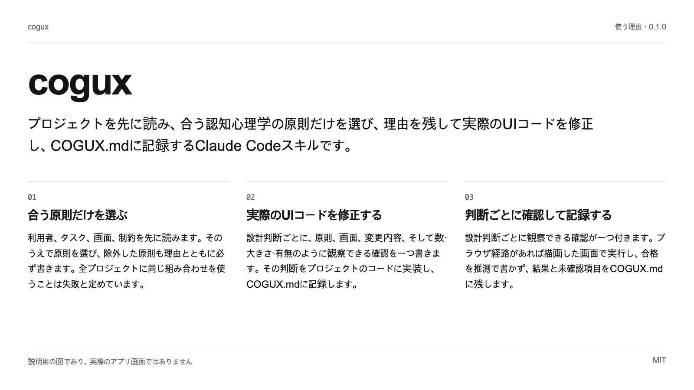
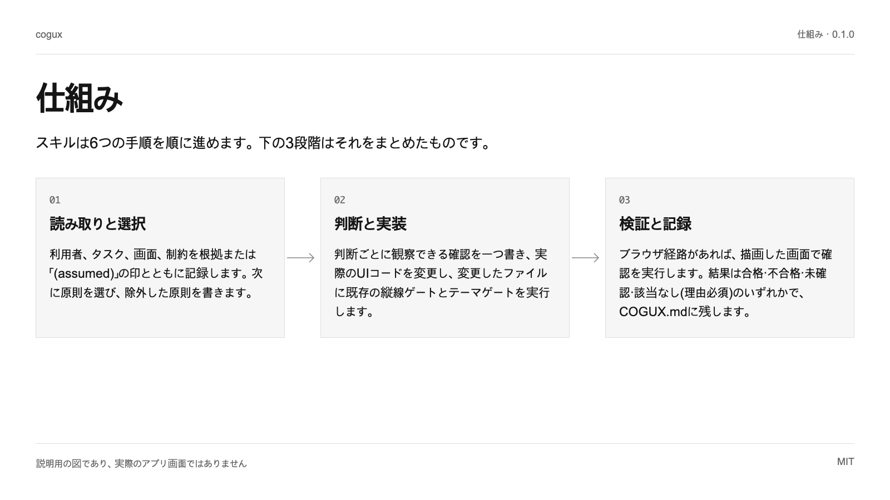
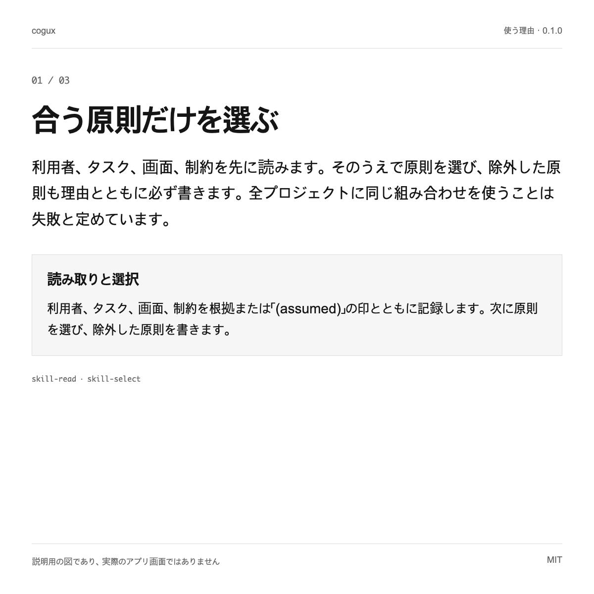
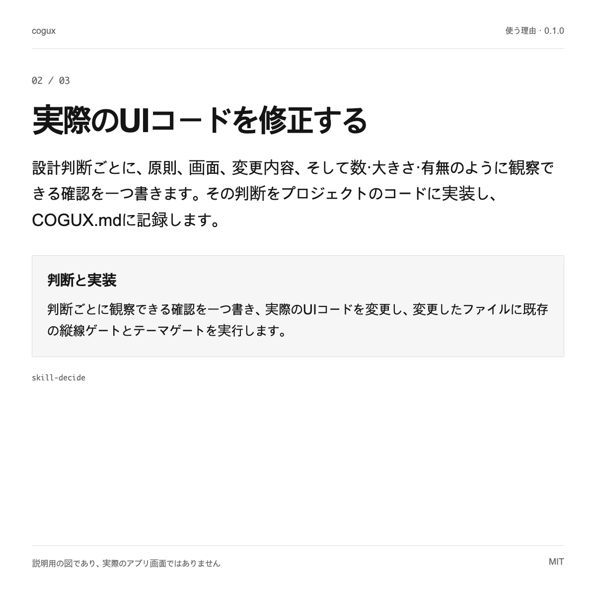
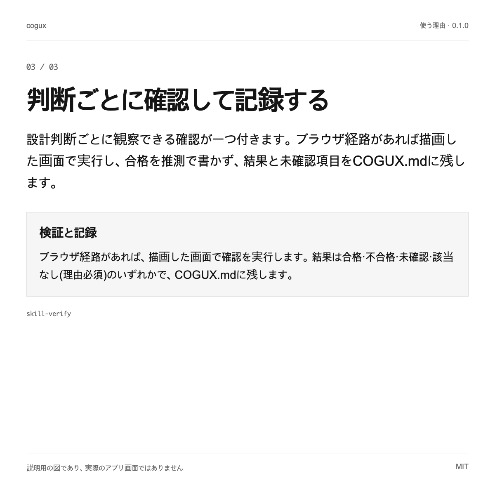

# cogux

プロジェクトを先に読み、合う認知心理学の原則だけを選び、理由を残して実際のUIコードを修正し、COGUX.mdに記録するClaude Codeスキルです。

[English](README.md) | [한국어](README.ko.md) | **日本語** | [简体中文](README.zh.md)



0.1.0 · MIT

## 使う理由

| | |
| --- | --- |
| 合う原則だけを選ぶ | 利用者、タスク、画面、制約を先に読みます。そのうえで原則を選び、除外した原則も理由とともに必ず書きます。全プロジェクトに同じ組み合わせを使うことは失敗と定めています。 |
| 実際のUIコードを修正する | 設計判断ごとに、原則、画面、変更内容、そして数・大きさ・有無のように観察できる確認を一つ書きます。その判断をプロジェクトのコードに実装し、COGUX.mdに記録します。 |
| 判断ごとに確認して記録する | 設計判断ごとに観察できる確認が一つ付きます。ブラウザ経路があれば描画した画面で実行し、合格を推測で書かず、結果と未確認項目をCOGUX.mdに残します。 |

## クイックスタート

gitとbashが必要です。Claude Codeでの利用を想定したスキルです。一部の手順は、このリポジトリにない~/.claude配下のローカルルールとゲートを参照します。

```text
git clone https://github.com/grow1023/cogux "$HOME/.claude/skills/cogux"
bash "$HOME/.claude/skills/cogux/gates/verify_cogux.sh" "$HOME/.claude/skills/cogux"
```

2つ目のコマンドは、スキル構造、原則ファイル、2つの例示プロジェクト、秘密情報の検査を確認します。全サブゲートが通ると VERIFY PASS で終わります。ただしテーマゲートを呼ぶサブゲートは所有者のローカルファイルが必要で、他のコンピューターでは失敗する可能性があります。

## 仕組み

スキルは6つの手順を順に進めます。下の3段階はそれをまとめたものです。



### 読み取りと選択

利用者、タスク、画面、制約を根拠または「(assumed)」の印とともに記録します。次に原則を選び、除外した原則を書きます。

### 判断と実装

判断ごとに観察できる確認を一つ書き、実際のUIコードを変更し、変更したファイルに既存の縦線ゲートとテーマゲートを実行します。

### 検証と記録

ブラウザ経路があれば、描画した画面で確認を実行します。結果は合格・不合格・未確認・該当なし(理由必須)のいずれかで、COGUX.mdに残します。

## 活用例

### 対照的な2つの例示プロジェクト

fixtures/には、初めて使う決済フローと集中学習アプリがあります。それぞれ修正前の画面、修正後の画面、COGUX.mdがあり、選ばれた原則は2つで異なります。

### 読んだ範囲を明記した原則47件

各原則ファイルに、定義、出典リンク、適用する場面、適用しない場面、観察による確認、実際に読んだ範囲があります。定義は出典から写さず、自分の言葉で書いています。







## 制約とプライバシー

- スキル本文とゲートは、所有者のローカルルール(~/.claude/rules/)とゲート(~/.claude/qa-canon/)を参照します。これらのファイルはこのリポジトリにないため、別のコンピューターにクローンすると一部のゲート手順が失敗する可能性があります。

- 定義は出典の冒頭部分とのみ照合しました。全文を読んだ原則はなく、元の研究も開いていません。

- 第三者の出典(Laws of UX、Nielsen Norman Group、jnd.org、arXiv)の権利はそれぞれの著作者に帰属し、MITライセンスはそれらに適用されません。自分の言葉で書いた要約がCC BY-NC-ND資料の改変物に当たるかは、法的に確認していません。

## 検証状況

- **実行確認済み**: verify_cogux.shをインストール済みのコピーで実行し、VERIFY PASSで終了しました。これは構造の検査であり、新しいプロジェクトで原則の選択が正しいことの証明ではありません。
- **文書に記載**: git cloneコマンドは実行していません。このREADMEを書いた時点でリモートリポジトリがまだなかったためです。

## 次のステップ

手順はSKILL.md、原則はreferences/INDEX.md、完成した例はfixtures/を参照してください。

<details>
<summary>根拠一覧</summary>

[JSON](docs/showcase/sources.json)

- `skill-intro`: `SKILL.md`, L6–L8 (コード確認済み)
- `skill-boundary`: `SKILL.md`, L10–L16 (コード確認済み)
- `skill-read`: `SKILL.md`, L22–L33 (コード確認済み)
- `skill-select`: `SKILL.md`, L35–L55 (コード確認済み)
- `skill-decide`: `SKILL.md`, L57–L69 (コード確認済み)
- `skill-verify`: `SKILL.md`, L71–L87 (コード確認済み)
- `library`: `references/INDEX.md`, L1–L22 (コード確認済み)
- `rights-and-scope`: `references/INDEX.md`, L5–L21 (文書に記載)
- `gate`: `gates/verify_cogux.sh`, L1–L34 (実行確認済み)
- `fixture-a`: `fixtures/checkout-first-time/COGUX.md`, L1–L77 (コード確認済み)
- `fixture-b`: `fixtures/study-adhd/COGUX.md`, L1–L77 (コード確認済み)
- `license`: `LICENSE`, L1–L3 (コード確認済み)

- `selects` → `skill-read`, `skill-select`
- `implements` → `skill-decide`
- `records` → `skill-verify`
- `read` → `skill-read`, `skill-select`
- `decide` → `skill-decide`
- `verify` → `skill-verify`
- `examples` → `fixture-a`, `fixture-b`
- `library` → `library`
- `local-rules` → `skill-boundary`, `skill-decide`
- `reading-scope` → `rights-and-scope`, `library`
- `third-party` → `rights-and-scope`, `license`
- `gate-run` → `gate`
- `clone` → `gate`
- `quickstart` → `gate`, `skill-verify`

</details>
