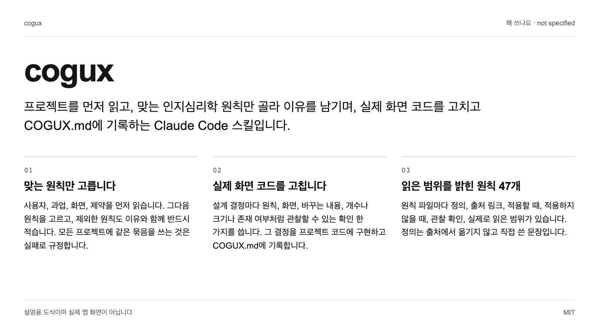
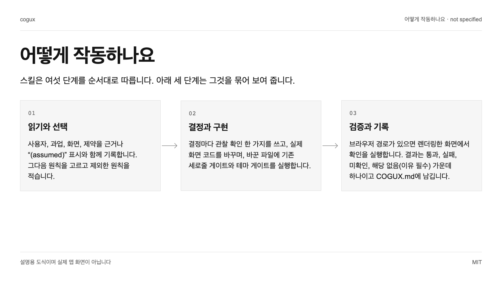
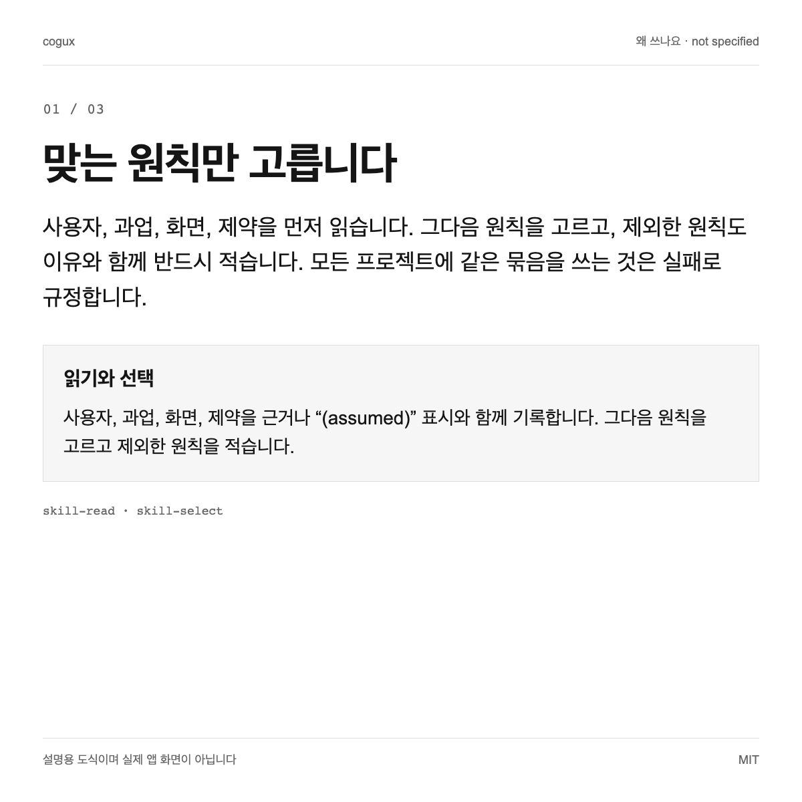
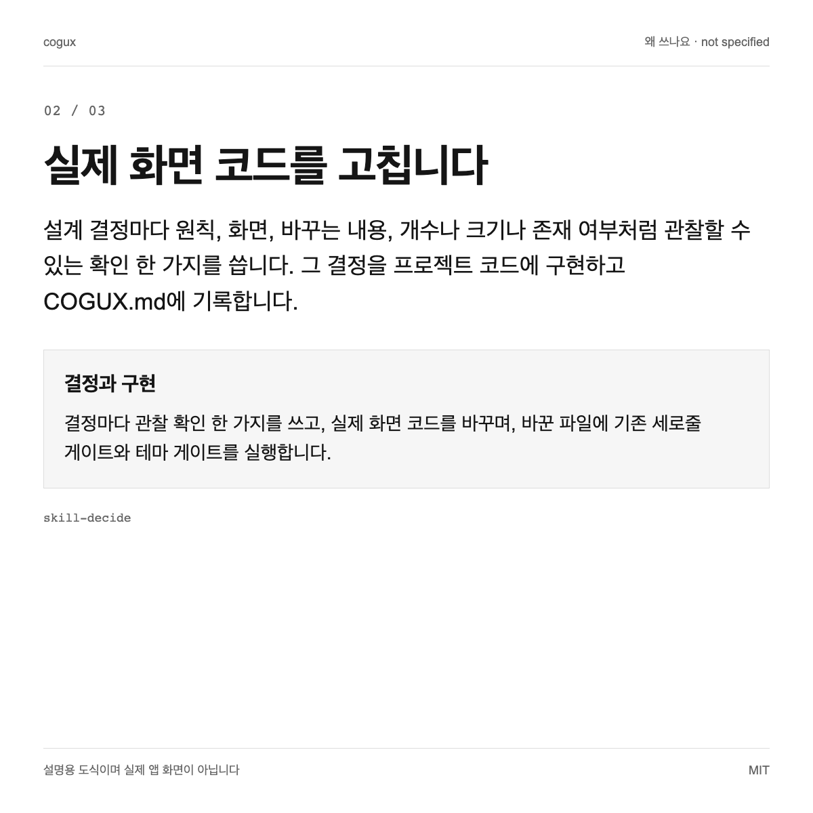
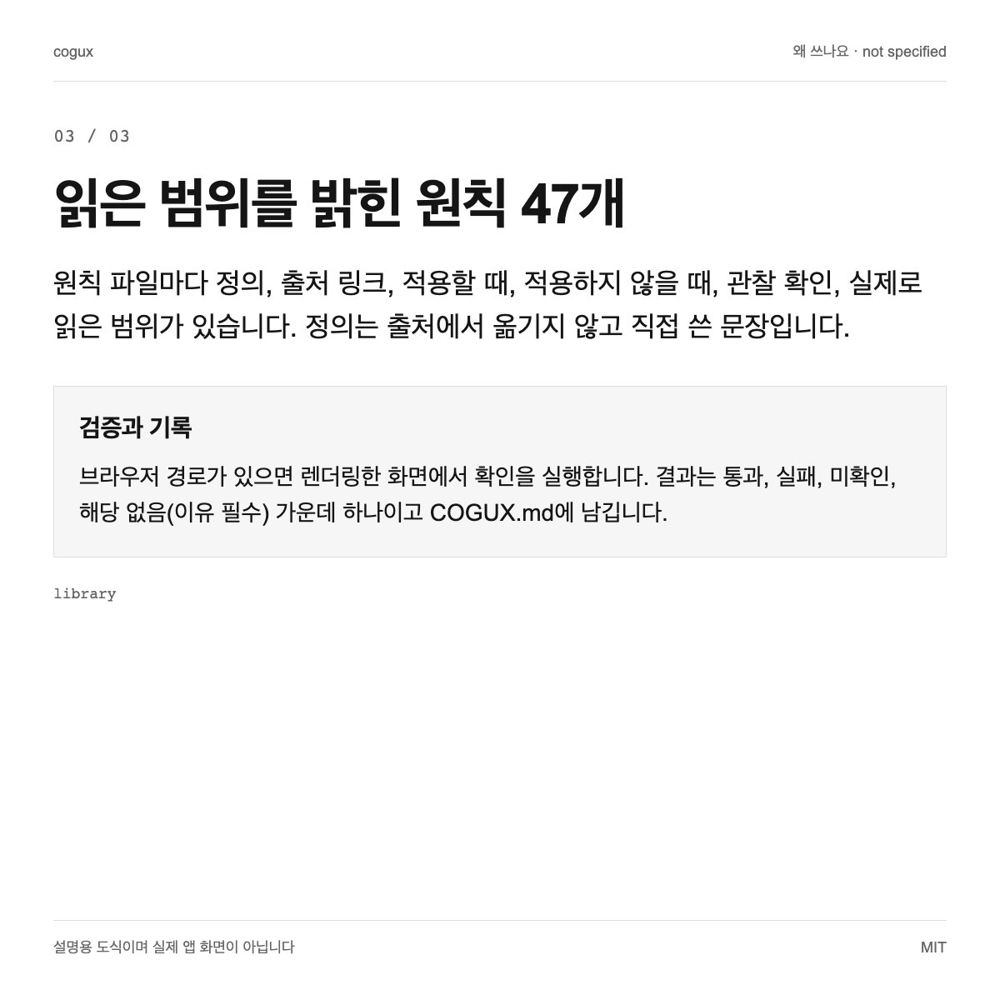

# cogux

프로젝트를 먼저 읽고, 맞는 인지심리학 원칙만 골라 이유를 남기며, 실제 화면 코드를 고치고 COGUX.md에 기록하는 Claude Code 스킬입니다.

[English](README.md) | **한국어** | [日本語](README.ja.md) | [简体中文](README.zh.md)



not specified · MIT

## 왜 쓰나요

| | |
| --- | --- |
| 맞는 원칙만 고릅니다 | 사용자, 과업, 화면, 제약을 먼저 읽습니다. 그다음 원칙을 고르고, 제외한 원칙도 이유와 함께 반드시 적습니다. 모든 프로젝트에 같은 묶음을 쓰는 것은 실패로 규정합니다. |
| 실제 화면 코드를 고칩니다 | 설계 결정마다 원칙, 화면, 바꾸는 내용, 개수나 크기나 존재 여부처럼 관찰할 수 있는 확인 한 가지를 씁니다. 그 결정을 프로젝트 코드에 구현하고 COGUX.md에 기록합니다. |
| 읽은 범위를 밝힌 원칙 47개 | 원칙 파일마다 정의, 출처 링크, 적용할 때, 적용하지 않을 때, 관찰 확인, 실제로 읽은 범위가 있습니다. 정의는 출처에서 옮기지 않고 직접 쓴 문장입니다. |

## 빠른 시작

git과 bash가 필요합니다. Claude Code에서 쓰도록 만든 스킬입니다. 일부 단계는 이 저장소에 없는 ~/.claude 아래의 로컬 규칙과 게이트를 가리킵니다.

```text
git clone https://github.com/grow1023/cogux "$HOME/.claude/skills/cogux"
bash "$HOME/.claude/skills/cogux/gates/verify_cogux.sh" "$HOME/.claude/skills/cogux"
```

두 번째 명령은 스킬 구조, 원칙 파일, 예시 프로젝트 둘, 비밀값 검사를 확인합니다. 모든 하위 게이트가 통과하면 VERIFY PASS로 끝납니다. 다만 테마 게이트를 부르는 하위 게이트는 소유자의 로컬 파일이 필요해서 다른 컴퓨터에서는 실패할 수 있습니다.

## 어떻게 작동하나요

스킬은 여섯 단계를 순서대로 따릅니다. 아래 세 단계는 그것을 묶어 보여 줍니다.



### 읽기와 선택

사용자, 과업, 화면, 제약을 근거나 “(assumed)” 표시와 함께 기록합니다. 그다음 원칙을 고르고 제외한 원칙을 적습니다.

### 결정과 구현

결정마다 관찰 확인 한 가지를 쓰고, 실제 화면 코드를 바꾸며, 바꾼 파일에 기존 세로줄 게이트와 테마 게이트를 실행합니다.

### 검증과 기록

브라우저 경로가 있으면 렌더링한 화면에서 확인을 실행합니다. 결과는 통과, 실패, 미확인, 해당 없음(이유 필수) 가운데 하나이고 COGUX.md에 남깁니다.

## 사용 예시

### 대조되는 예시 프로젝트 둘

fixtures/에는 처음 쓰는 결제 흐름과 집중 공부 앱이 있습니다. 각각 수정 전 화면, 수정한 화면, COGUX.md가 있고, 두 프로젝트가 고른 원칙은 서로 다릅니다.







## 한계와 개인정보

- 스킬 본문과 게이트는 소유자의 로컬 규칙(~/.claude/rules/)과 게이트(~/.claude/qa-canon/)를 가리킵니다. 그 파일은 이 저장소에 없어서, 다른 컴퓨터에 받으면 일부 게이트 단계가 실패할 수 있습니다.

- 정의는 출처의 앞부분과만 대조했습니다. 전문을 끝까지 읽은 원칙은 없고, 원 연구도 열어 보지 않았습니다.

- 제3자 출처(Laws of UX, Nielsen Norman Group, jnd.org, arXiv)의 권리는 각 저작자에게 있고 MIT 라이선스는 그 출처에 적용되지 않습니다. 직접 쓴 요약이 CC BY-NC-ND 자료의 변경물에 해당하는지는 법적으로 확인하지 못했습니다.

## 검증 상태

- **실행 확인**: verify_cogux.sh를 설치한 복사본에서 실행했고 VERIFY PASS로 끝났습니다. 이것은 구조를 검사하는 것이며, 새 프로젝트에서 원칙 선택이 옳은지는 증명하지 않습니다.
- **문서 기준**: git clone 명령은 실행하지 않았습니다. 이 README를 쓸 때 원격 저장소가 아직 없었기 때문입니다.

## 다음 단계

작업 순서는 SKILL.md, 원칙은 references/INDEX.md, 완성된 예시는 fixtures/를 보십시오.

<details>
<summary>근거 목록</summary>

[JSON](docs/showcase/sources.json)

- `skill-intro`: `SKILL.md`, L6–L8 (코드 확인)
- `skill-boundary`: `SKILL.md`, L10–L16 (코드 확인)
- `skill-read`: `SKILL.md`, L22–L33 (코드 확인)
- `skill-select`: `SKILL.md`, L35–L55 (코드 확인)
- `skill-decide`: `SKILL.md`, L57–L69 (코드 확인)
- `skill-verify`: `SKILL.md`, L71–L87 (코드 확인)
- `library`: `references/INDEX.md`, L1–L22 (코드 확인)
- `readme-source`: `README.md`, L10–L16 (문서 기준)
- `gate`: `gates/verify_cogux.sh`, L1–L34 (실행 확인)
- `fixture-a`: `fixtures/checkout-first-time/COGUX.md`, L1–L77 (코드 확인)
- `fixture-b`: `fixtures/study-adhd/COGUX.md`, L1–L77 (코드 확인)
- `license`: `LICENSE`, L1–L3 (코드 확인)

- `selects` → `skill-read`, `skill-select`
- `implements` → `skill-decide`
- `library` → `library`
- `read` → `skill-read`, `skill-select`
- `decide` → `skill-decide`
- `verify` → `skill-verify`
- `examples` → `fixture-a`, `fixture-b`
- `local-rules` → `skill-boundary`, `skill-decide`
- `reading-scope` → `readme-source`, `library`
- `third-party` → `readme-source`, `license`
- `gate-run` → `gate`
- `clone` → `gate`
- `quickstart` → `gate`, `skill-verify`

</details>
