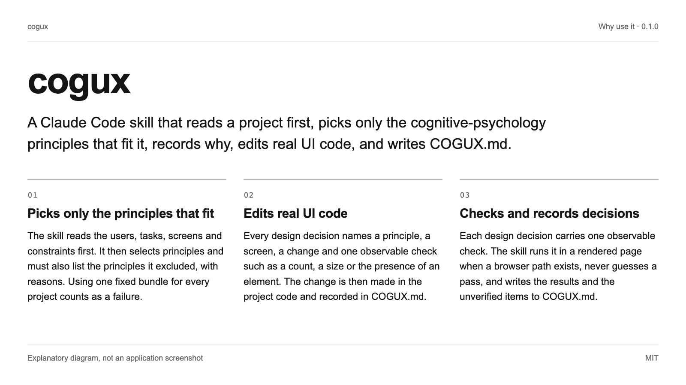
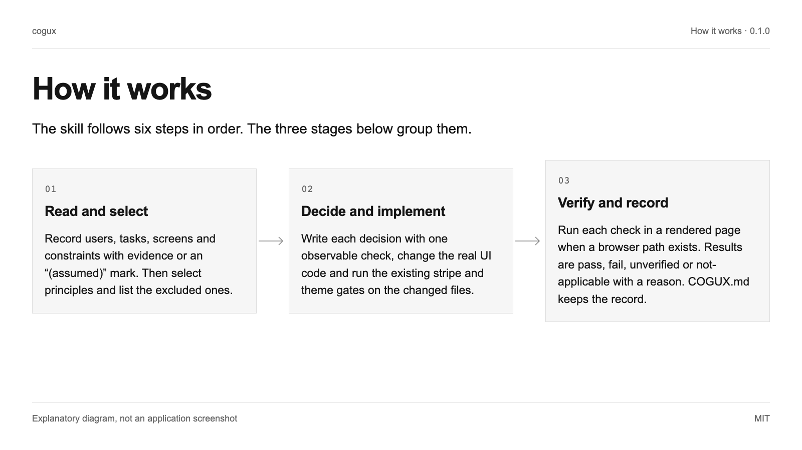
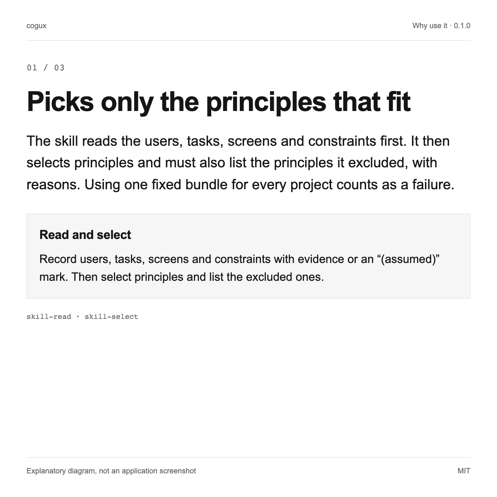
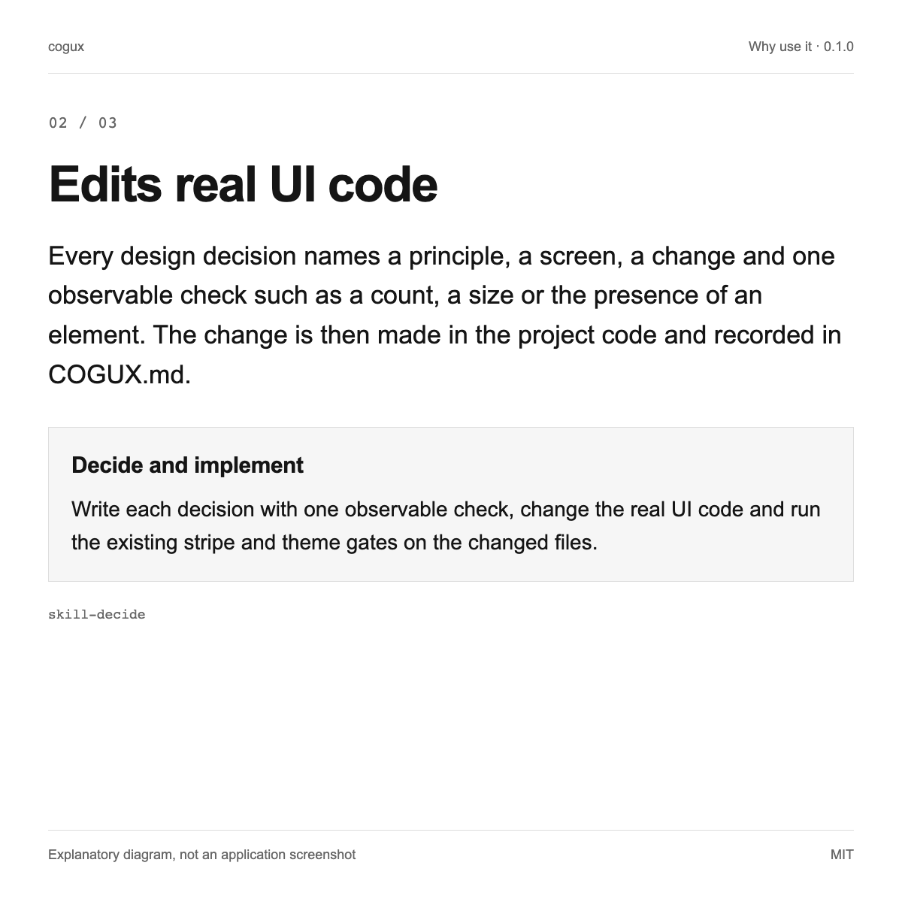
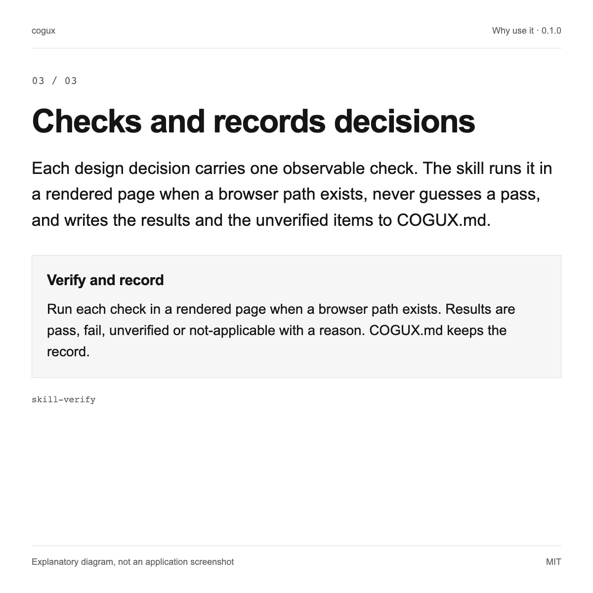

# cogux

A Claude Code skill that reads a project first, picks only the cognitive-psychology principles that fit it, records why, edits real UI code, and writes COGUX.md.

**English** | [한국어](README.ko.md) | [日本語](README.ja.md) | [简体中文](README.zh.md)



0.1.0 · MIT

## Why use it

| | |
| --- | --- |
| Picks only the principles that fit | The skill reads the users, tasks, screens and constraints first. It then selects principles and must also list the principles it excluded, with reasons. Using one fixed bundle for every project counts as a failure. |
| Edits real UI code | Every design decision names a principle, a screen, a change and one observable check such as a count, a size or the presence of an element. The change is then made in the project code and recorded in COGUX.md. |
| Checks and records decisions | Each design decision carries one observable check. The skill runs it in a rendered page when a browser path exists, never guesses a pass, and writes the results and the unverified items to COGUX.md. |

## Quick start

git and bash. The skill is meant to be used in Claude Code. Some steps refer to local rules and gates under ~/.claude that this repository does not contain.

```text
git clone https://github.com/grow1023/cogux "$HOME/.claude/skills/cogux"
bash "$HOME/.claude/skills/cogux/gates/verify_cogux.sh" "$HOME/.claude/skills/cogux"
```

The second command checks the skill structure, the principle files, the two example projects and the secret scan. It ends with VERIFY PASS when every sub-gate passes, but the sub-gate that runs the theme gate needs the owner’s local file and can fail on another computer.

## How it works

The skill follows six steps in order. The three stages below group them.



### Read and select

Record users, tasks, screens and constraints with evidence or an “(assumed)” mark. Then select principles and list the excluded ones.

### Decide and implement

Write each decision with one observable check, change the real UI code and run the existing stripe and theme gates on the changed files.

### Verify and record

Run each check in a rendered page when a browser path exists. Results are pass, fail, unverified or not-applicable with a reason. COGUX.md keeps the record.

## Use cases

### Two contrasting example projects

fixtures/ holds a first-time checkout flow and a focus-study app. Each has the before page, the changed page and a COGUX.md. The two projects select different principles.

### A library of 47 principles with a stated reading scope

Each principle file has a definition, a source link, when to apply, when not to apply, an observable check and the scope that was actually read. Definitions are written in the author’s own words, not copied from the sources.







## Limits and privacy

- The skill text and the gates refer to the owner’s local rules in ~/.claude/rules/ and gates in ~/.claude/qa-canon/. Those files are not in this repository, so a clone on another computer can fail some gate steps.

- Definitions were compared with the opening sections of the sources only. No principle was read in full, and the original studies were not opened.

- Third-party sources (Laws of UX, Nielsen Norman Group, jnd.org, arXiv) keep their own rights. The MIT license does not cover them. Whether the own-words summaries count as derivative works of CC BY-NC-ND material was not legally checked.

## Verification

- **Execution verified**: verify_cogux.sh was run on the installed copy and ended with VERIFY PASS. This checks structure, not whether the principle selection is right for a new project.
- **Documented**: The git clone command was not run because the remote repository did not exist when this README was written.

## Next steps

Read SKILL.md for the workflow, references/INDEX.md for the principles, and fixtures/ for finished examples.

<details>
<summary>Source map</summary>

[JSON](docs/showcase/sources.json)

- `skill-intro`: `SKILL.md`, L6–L8 (Source inspected)
- `skill-boundary`: `SKILL.md`, L10–L16 (Source inspected)
- `skill-read`: `SKILL.md`, L22–L33 (Source inspected)
- `skill-select`: `SKILL.md`, L35–L55 (Source inspected)
- `skill-decide`: `SKILL.md`, L57–L69 (Source inspected)
- `skill-verify`: `SKILL.md`, L71–L87 (Source inspected)
- `library`: `references/INDEX.md`, L1–L22 (Source inspected)
- `rights-and-scope`: `references/INDEX.md`, L5–L21 (Documented)
- `gate`: `gates/verify_cogux.sh`, L1–L34 (Execution verified)
- `fixture-a`: `fixtures/checkout-first-time/COGUX.md`, L1–L77 (Source inspected)
- `fixture-b`: `fixtures/study-adhd/COGUX.md`, L1–L77 (Source inspected)
- `license`: `LICENSE`, L1–L3 (Source inspected)

- `selects` → `skill-read`, `skill-select`
- `implements` → `skill-decide`
- `records` → `skill-verify`
- `read` → `skill-read`, `skill-select`
- `decide` → `skill-decide`
- `verify` → `skill-verify`
- `examples` → `fixture-a`, `fixture-b`
- `library` → `library`
- `local-rules` → `skill-boundary`, `skill-decide`
- `reading-scope` → `rights-and-scope`, `library`
- `third-party` → `rights-and-scope`, `license`
- `gate-run` → `gate`
- `clone` → `gate`
- `quickstart` → `gate`, `skill-verify`

</details>
