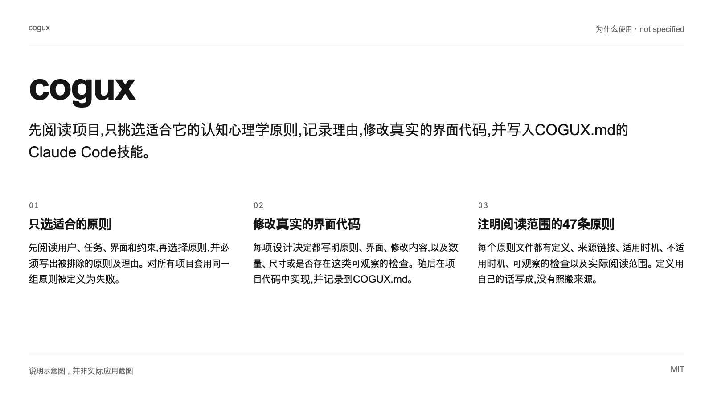
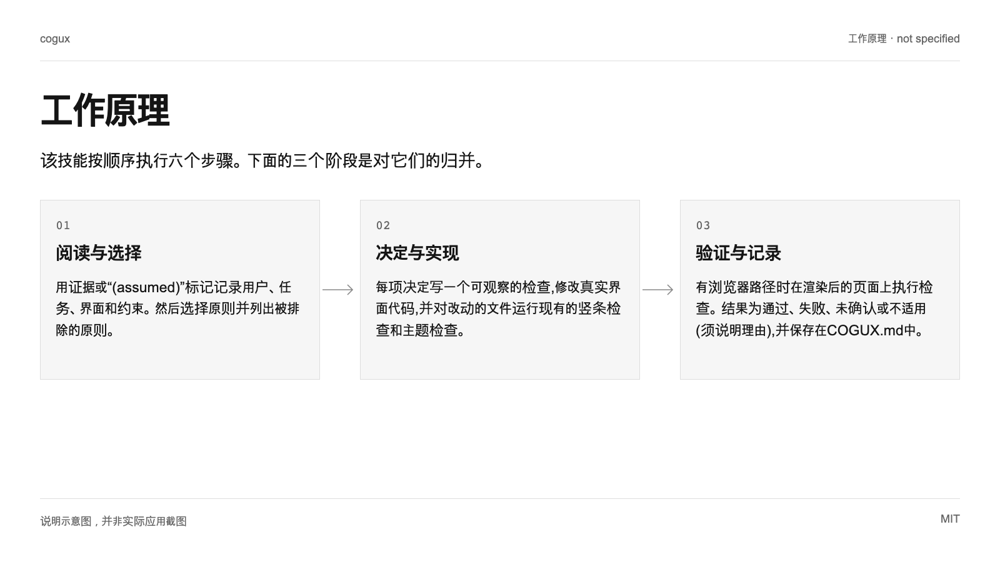
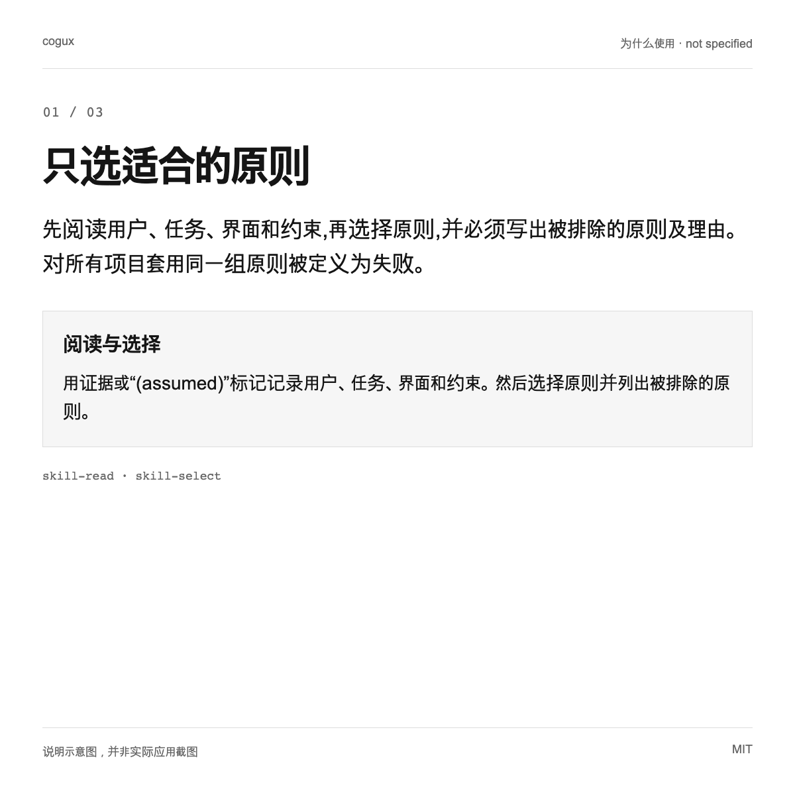
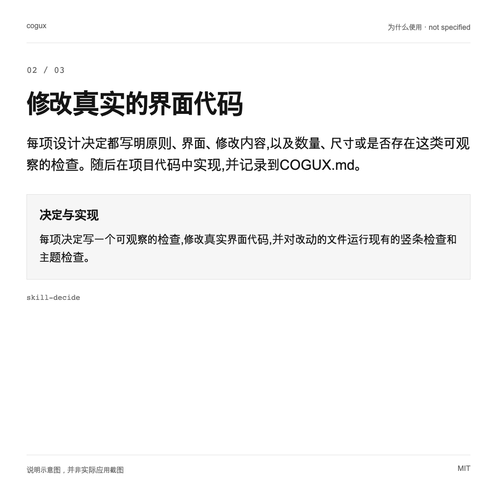
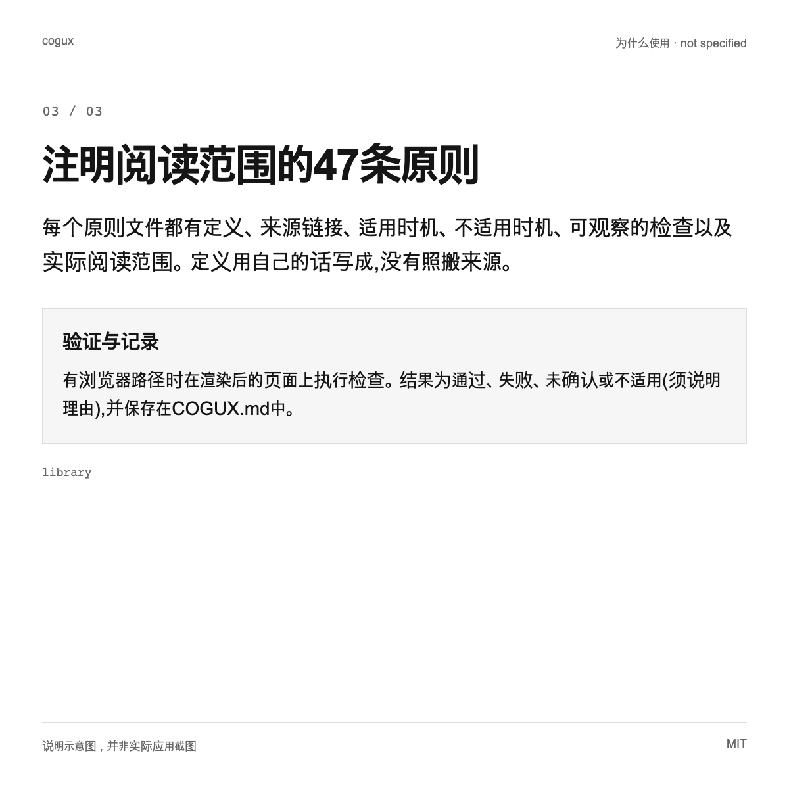

# cogux

先阅读项目,只挑选适合它的认知心理学原则,记录理由,修改真实的界面代码,并写入COGUX.md的Claude Code技能。

[English](README.md) | [한국어](README.ko.md) | [日本語](README.ja.md) | **简体中文**



not specified · MIT

## 为什么使用

| | |
| --- | --- |
| 只选适合的原则 | 先阅读用户、任务、界面和约束,再选择原则,并必须写出被排除的原则及理由。对所有项目套用同一组原则被定义为失败。 |
| 修改真实的界面代码 | 每项设计决定都写明原则、界面、修改内容,以及数量、尺寸或是否存在这类可观察的检查。随后在项目代码中实现,并记录到COGUX.md。 |
| 注明阅读范围的47条原则 | 每个原则文件都有定义、来源链接、适用时机、不适用时机、可观察的检查以及实际阅读范围。定义用自己的话写成,没有照搬来源。 |

## 快速开始

需要git和bash。该技能面向Claude Code使用。部分步骤引用了本仓库中不存在的~/.claude下的本地规则和检查脚本。

```text
git clone https://github.com/grow1023/cogux "$HOME/.claude/skills/cogux"
bash "$HOME/.claude/skills/cogux/gates/verify_cogux.sh" "$HOME/.claude/skills/cogux"
```

第二条命令检查技能结构、原则文件、两个示例项目和密钥扫描。所有子检查通过后以VERIFY PASS结束。但调用主题检查的子检查需要所有者的本地文件,在其他电脑上可能失败。

## 工作原理

该技能按顺序执行六个步骤。下面的三个阶段是对它们的归并。



### 阅读与选择

用证据或“(assumed)”标记记录用户、任务、界面和约束。然后选择原则并列出被排除的原则。

### 决定与实现

每项决定写一个可观察的检查,修改真实界面代码,并对改动的文件运行现有的竖条检查和主题检查。

### 验证与记录

有浏览器路径时在渲染后的页面上执行检查。结果为通过、失败、未确认或不适用(须说明理由),并保存在COGUX.md中。

## 使用场景

### 两个对照的示例项目

fixtures/中有首次使用的结账流程和专注学习应用。各自包含修改前页面、修改后页面和COGUX.md,两个项目选择的原则不同。







## 限制与隐私

- 技能正文和检查脚本引用所有者本地的规则(~/.claude/rules/)和检查脚本(~/.claude/qa-canon/)。这些文件不在本仓库中,在其他电脑上克隆后部分检查步骤可能失败。

- 定义只与来源的开头部分做了对照。没有任何原则读过全文,也没有打开原始研究。

- 第三方来源(Laws of UX、Nielsen Norman Group、jnd.org、arXiv)的权利归各自作者所有,MIT许可证不适用于它们。自己撰写的摘要是否构成CC BY-NC-ND材料的衍生作品,未做法律核实。

## 验证状态

- **已验证运行**: 在已安装的副本上运行了verify_cogux.sh,以VERIFY PASS结束。这检查的是结构,并不证明在新项目中原则选择正确。
- **文档说明**: 没有运行git clone命令,因为撰写本README时远程仓库尚不存在。

## 下一步

工作流程见SKILL.md,原则见references/INDEX.md,完整示例见fixtures/。

<details>
<summary>依据列表</summary>

[JSON](docs/showcase/sources.json)

- `skill-intro`: `SKILL.md`, L6–L8 (已检查代码)
- `skill-boundary`: `SKILL.md`, L10–L16 (已检查代码)
- `skill-read`: `SKILL.md`, L22–L33 (已检查代码)
- `skill-select`: `SKILL.md`, L35–L55 (已检查代码)
- `skill-decide`: `SKILL.md`, L57–L69 (已检查代码)
- `skill-verify`: `SKILL.md`, L71–L87 (已检查代码)
- `library`: `references/INDEX.md`, L1–L22 (已检查代码)
- `readme-source`: `README.md`, L10–L16 (文档说明)
- `gate`: `gates/verify_cogux.sh`, L1–L34 (已验证运行)
- `fixture-a`: `fixtures/checkout-first-time/COGUX.md`, L1–L77 (已检查代码)
- `fixture-b`: `fixtures/study-adhd/COGUX.md`, L1–L77 (已检查代码)
- `license`: `LICENSE`, L1–L3 (已检查代码)

- `selects` → `skill-read`, `skill-select`
- `implements` → `skill-decide`
- `library` → `library`
- `read` → `skill-read`, `skill-select`
- `decide` → `skill-decide`
- `verify` → `skill-verify`
- `examples` → `fixture-a`, `fixture-b`
- `local-rules` → `skill-boundary`, `skill-decide`
- `reading-scope` → `readme-source`, `library`
- `third-party` → `readme-source`, `license`
- `gate-run` → `gate`
- `clone` → `gate`
- `quickstart` → `gate`, `skill-verify`

</details>
